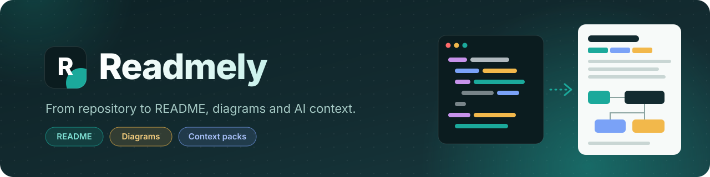
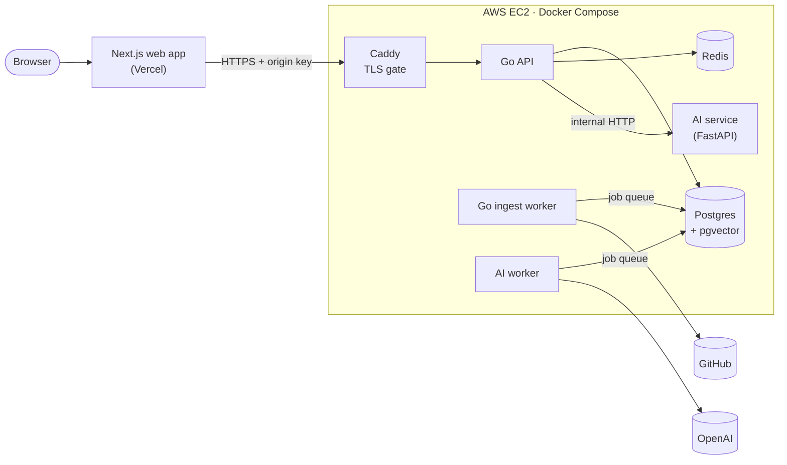

<div align="center">



<br>

### *“Your code already tells the story. Readmely writes it down.”*

Paste a GitHub repository. Get a README worth committing, an architecture diagram, and a context pack your AI coding tools can read.

<p>
  <a href="https://readmely.gitanshu.me"><b>Live app</b></a> ·
  <a href="docs/local-development.md"><b>Run locally</b></a> ·
  <a href="docs/deploy/aws.md"><b>Deploy</b></a> ·
  <a href="plans/00-architecture.md"><b>Architecture</b></a>
</p>

<p>
  <a href="https://github.com/Gitax18/readmely/actions/workflows/ci.yml"></a>
  
</p>

<p>
  
  
  
  
  
  
  
  <br>
  
  
  
  
  
  
  
  
</p>

</div>

---

## Contents

- [What it does](#what-it-does)
- [How it works](#how-it-works)
- [Architecture](#architecture)
- [Tech stack](#tech-stack)
- [Quick start](#quick-start)
- [Deployment](#deployment)
- [Project structure](#project-structure)
- [Security](#security)
- [Status and roadmap](#status-and-roadmap)
- [Contributing](#contributing)

## What it does

Readmely reads a repository **once** and builds a structured picture of it: languages, frameworks,
entry points, services, environment variables and a plain-English summary. Every output is made
from that picture, not from raw code. That is why each output is fast and costs a few credits
instead of a million tokens.

| Output | What you get |
|---|---|
| **README** | Standard, minimal or detailed layouts with sections chosen for the project type. Edit beside a live preview, rewrite one section with an instruction, keep a version history, and get a health score that lists what is missing. |
| **Architecture diagram** | An overview of the project's real parts and how they talk, with colour-coded categories. Every part must point to real files. Download it as SVG or PNG, or embed it in the README. |
| **Context pack** | A ready-made `CLAUDE.md`, `AGENTS.md`, Cursor rules or generic `CONTEXT.md`, with a token estimate for each. Your AI tools understand the project without you pasting code. |
| **Analysis** | Languages and line counts, frameworks, entry points, run and test commands, Docker services, env vars and a file tree. Secrets found in the code are never stored or shown. |

Sign in with an emailed code, Google or GitHub. Every account starts with free credits.

## How it works

1. **Paste a repository URL.** The API checks the repository and queues an analysis job.
2. **Analyse.** The Go ingest worker downloads the repository at one commit. It treats every file
   as untrusted, extracts facts with no AI at all, and strips secrets.
3. **Summarise.** The Python AI worker makes one structured model call to write the summary. A
   daily spend cap and per-job credit holds stop runaway cost, and failed jobs are refunded.
4. **Generate.**
   - The **context pack** is built straight from the facts: instant, and no model call.
   - The **README** is written as typed sections and assembled in code, so the model cannot change
     the structure.
   - The **diagram** is a small typed graph that we lay out and render ourselves. The model never
     draws.

## Architecture



- **One job queue in Postgres.** Go and Python never share code, only the database and an
  internal HTTP API described by OpenAPI [contracts](contracts/README.md).
- **Only the AI worker talks to a model.** It is the single place where cost caps and
  prompt-injection handling live.
- **Deterministic wherever possible.** Facts, the context pack and the diagram layout need no model
  call at all.
- **The browser never reaches the API.** The web server proxies an allowlist of routes, and the API
  answers only requests that carry the web server's key.

The full design is in [plans/00-architecture.md](plans/00-architecture.md).

## Tech stack

| Part | Tech | Folder |
|---|---|---|
| Core API and workers | Go 1.27, pgx, sqlc, goose | [`services/core`](services/core) |
| AI service and worker | Python 3.13, FastAPI, Pydantic, uv | [`services/ai`](services/ai) |
| Web app | Next.js 16, React 19, TypeScript, Tailwind, shadcn/ui | [`apps/web`](apps/web) |
| Data | PostgreSQL 17 with pgvector, Redis 8 | [`infra`](infra) |
| API contracts | OpenAPI 3, generated Go, Python and TypeScript types | [`contracts`](contracts) |
| Hosting | Vercel (web), AWS EC2 with Caddy (backend), ECR, S3, SSM | [`infra/prod`](infra/prod), [`infra/aws`](infra/aws) |
| CI/CD | GitHub Actions: lint, tests, contract and secret checks, Trivy, OIDC deploys | [`.github/workflows`](.github/workflows) |

## Quick start

You need Docker with Compose, Go 1.27+, [uv](https://docs.astral.sh/uv/), Node 24 with
[pnpm](https://pnpm.io/) 12, and `make`.

```sh
cp .env.example .env     # then change every password; letters, digits, - and _ only
make up                  # Postgres, Redis and RustFS on 127.0.0.1, migrations applied
make up-app              # the API, workers, AI service and web app in containers
open http://127.0.0.1:3000
```

To sign in, enter any email address and read the code from the API log
(`make logs` or `make run-api`).

<details>
<summary><b>More: running on the host, tests, database and OAuth</b></summary>

<br>

| Command | What it does |
|---|---|
| `make hooks` | Turn on the git hooks (commit message and staged-file checks). Run it once. |
| `make run-api` · `make run-web` | Run the API or the web app on the host instead of in a container |
| `make check` | Everything CI runs that needs no containers: lint, tests, generated code, audit, secrets |
| `make test-e2e` · `make test-e2e-stack` | Browser tests against a fake API, or against the real stack |
| `make db-status` · `make db-new NAME=…` | Migrations |
| `make gen` | Regenerate types from the OpenAPI contracts |
| `make help` | Every target |

Signing in with Google or GitHub locally, all the settings, and the database roles are covered in
**[docs/local-development.md](docs/local-development.md)**.

</details>

## Deployment

| Part | Where | How |
|---|---|---|
| Web app | **Vercel** | Git integration on `main` |
| Backend | **AWS**: one EC2 t3.small running Docker Compose | `Deploy` workflow: images to ECR, rollout through SSM, sign-in by GitHub OIDC |

The backend sits behind **Caddy** (automatic TLS). It answers only the web server, has **no SSH
port**, reads its secrets from **SSM Parameter Store**, and backs up Postgres to **S3** every
night. It costs about **$21 a month**, paid from AWS credits. Budgets and anomaly alerts warn
long before a real charge.

Step by step: **[docs/deploy/aws.md](docs/deploy/aws.md)**

## Project structure

```text
readmely/
├── apps/web/          Next.js app: landing page, dashboard, README editor, diagram viewer
├── services/
│   ├── core/          Go: API (cmd/api), ingest worker, migrations, sign-in, credits
│   └── ai/            Python: FastAPI service and AI worker (summaries, README, diagram)
├── contracts/         OpenAPI specs and generated types for every language
├── infra/
│   ├── docker/        Dockerfiles (distroless and slim, non-root)
│   ├── prod/          Production compose, Caddyfile, instance scripts
│   └── aws/           IAM policies, lifecycle rules and budgets
├── docs/              Local development, deployment runbook, assets
├── plans/             Architecture, security model and per-phase plans
└── scripts/           Repository tooling
```

## Security

Readmely handles other people's code, so security is designed in, not bolted on.

- **Untrusted input stays contained.** Repositories are read in a locked-down worker:
  read-only filesystem, all capabilities dropped, and size limits.
- **Secrets are removed** before any text reaches a model, and are never stored or shown.
- **Repository text is data, never instructions.** Model output is typed and validated, and
  structure is assembled in code.
- **Every endpoint checks ownership.** Sessions are hardened and CSRF-protected. Sign-in alerts
  arrive by email.
- **Credits and a daily cap** bound model spend before any call is made.
- **CI scans** for leaked secrets (gitleaks), vulnerable dependencies, and image CVEs (Trivy).
  Actions and images are pinned by digest.

Threat model and the per-feature checklist: [plans/security.md](plans/security.md). Never commit
`.env`.

## Status and roadmap

Version 1 is being built phase by phase. Each phase is a reviewed pull request.

- [x] Foundations, database, and sign-in (email codes, Google, GitHub)
- [x] Account essentials: sessions, connected accounts, account deletion
- [x] Projects, import and analysis
- [x] AI foundation and credits
- [x] Context pack
- [x] README generator with editor and history
- [x] Overview and ER diagrams
- [ ] UI redesign: design system and every screen *(in progress)*
- [ ] Release: AWS deployment and hardening *(next)*

Later: private repositories through a GitHub App, two-factor authentication, resume and portfolio
generation. Details are in [plans/v1-roadmap.md](plans/v1-roadmap.md).

## Contributing

- **Branches:** `<type>/<short-name>`, for example `feat/auth-totp` or `fix/credit-race`.
- **Commits:** `<type>(<scope>): <summary>`, in the imperative, under 72 characters. Types: `feat`,
  `fix`, `docs`, `test`, `refactor`, `perf`, `security`, `build`, `ci`, `chore`.
- Run `make hooks` once, and `make check` before you push. `main` only takes reviewed merges with
  green CI.

Full conventions are in [plans/README.md](plans/README.md#git-conventions).

<div align="center">
<br>
<sub>Built by <a href="https://github.com/Gitax18">@Gitax18</a> · Go, Python and TypeScript</sub>
</div>
