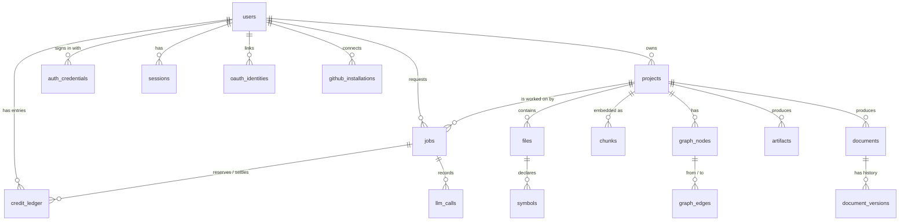

# Phase 1 · Database

**Status:** Draft, awaiting review (agreed 2026-11-18: design the whole MVP model, build only the core tables now; **goose** migrations; **sqlc** for Go and **psycopg + Pydantic** for Python; **UUIDv7** keys).

**Goal:** one reviewed entity model for the whole MVP, and the tables that Phases 2 to 5 need first, built with migrations you can trust: repeatable from an empty database, least-privilege access, generated type-checked Go queries, and tests that attack the parts that can go wrong (the job queue and the credit ledger).

## 1. Conventions (apply to every table)

| Topic | Rule |
|---|---|
| Keys | `id uuid primary key default uuid_generate_v7()`. Postgres 17 has no built-in v7, so migration 1 adds a small SQL function (swap for the built-in `uuidv7()` when we move to Postgres 18). Any writer, Go or Python, gets a time-ordered, unguessable ID with no library |
| Time | `timestamptz` only, always UTC. `created_at default now()`; `updated_at` maintained by one shared trigger, never by app code |
| Names | `snake_case`, plural tables, `<table>_id` foreign keys, constraints named `<table>_<columns>_<kind>` so errors are readable |
| Enumerations | `text` plus a named `CHECK` (adding a value is a one-line migration; native enums are painful to change) |
| Email | stored as given, unique on `lower(email)` |
| Foreign keys | always explicit `ON DELETE`, always indexed |
| Money-like values | credits are integers (`bigint`), never floats |
| JSON | `jsonb` only for payloads whose shape belongs to another contract (job payload); everything queryable is a column |
| Deletion | **real deletes**, no soft-delete flags (T14: deleting a project or account must remove the data). Children cascade. Details in §4 |
| Secrets | none in the schema or seed data; sensitive columns added later (TOTP) are encrypted in application code and named `*_encrypted` |

## 2. Entity model (whole MVP, designed now)

| Group | Tables | Built in |
|---|---|---|
| Core (this phase) | `users`, `projects`, `jobs`, `credit_ledger` | Phase 1 |
| Auth | `auth_credentials`, `totp_secrets`, `recovery_codes`, `sessions`, `oauth_identities`, `email_verifications` | Phase 2 (columns depend on the still-open password vs passwordless choice) |
| GitHub | `github_installations`, repository metadata on `projects` | Phase 3 |
| Index and graph | `files`, `symbols`, `graph_nodes`, `graph_edges` | Phase 4 |
| AI | `chunks` (pgvector, always filtered by `project_id`), `llm_calls` (provider, model, tokens, cost, job) | Phase 5 |
| Outputs | `documents`, `document_versions`, `artifacts` (objects in S3) | Phases 6 to 8 |

Every table below `projects` carries `project_id` and cascades from it, so "delete a project" is one statement and a test proves nothing is left behind.

### Core tables built now

**`users`**: `id`, `email` (not null), `email_verified_at`, `display_name`, `status` (`active` | `suspended`), `created_at`, `updated_at`. Unique on `lower(email)`. Credentials are *not* here; they live in Phase 2 tables so a query that selects users can never leak a hash.

**`projects`**: `id`, `user_id` (FK, cascade), `name` (1 to 100 chars), `status` (`draft` | `importing` | `ready` | `failed`), `created_at`, `updated_at`. Unique on `(user_id, lower(name))`. Phase 3 adds the repository columns.

**`jobs`** (the Postgres queue from D2, shared by Go and Python):

| Column | Meaning |
|---|---|
| `id`, `user_id`, `project_id` (nullable) | who asked, and for which project |
| `kind` | `check`-constrained list, starting with `ingest`, `generate_readme`, `generate_diagram`, `build_context_pack` |
| `payload jsonb` | input, size-limited by a `CHECK` (default 64 KiB) |
| `status` | `queued` → `running` → `succeeded` \| `failed` \| `cancelled` |
| `attempts`, `max_attempts` | retry bookkeeping; a job past its limit becomes `failed` |
| `run_after` | earliest start; used for backoff |
| `locked_by`, `lease_expires_at` | the worker holding it; a crashed worker's lease expires and the job is claimed again |
| `idempotency_key` | unique per user, so a retried request cannot enqueue twice |
| `error_code` | short code, never a stack trace or provider text |
| `created_at`, `updated_at`, `finished_at` | |

Claiming uses `SELECT … FOR UPDATE SKIP LOCKED` ordered by `run_after`, in one statement, backed by a partial index on `(run_after) WHERE status = 'queued'`.

**`credit_ledger`** (T11, append-only): `id`, `user_id`, `delta bigint` (non-zero), `kind` (`grant` | `reserve` | `settle` | `refund` | `adjustment`), `job_id` (nullable FK), `reservation_id` (links a settle or refund to its reserve), `idempotency_key` (unique), `note`, `created_at`. A trigger rejects `UPDATE` and `DELETE`. Balance is the sum of `delta` (a view, `credit_balances`); a cached balance table is added only if measurement says so. A reserve takes a row lock on the user, checks the balance, and inserts, all in one transaction, so concurrent jobs cannot overspend.

## 3. Tooling

- **goose**, pinned as a `go tool` and embedded in a small `cmd/migrate` binary, so production runs migrations from our own image with no extra download. Migrations are plain SQL in `db/migrations/`, numbered by timestamp.
- **Rules:** forward-only in production; `down` exists for development and is exercised by tests (up, down to zero, up again); a migration is never edited after it merges; destructive changes go in two steps (stop using, then drop).
- **sqlc** reads `db/migrations/` as the schema and `services/core/internal/db/queries/*.sql` as the queries, and writes type-checked Go to `services/core/internal/db/store/`. It joins `make gen` and `make gen-check`, so a query that no longer matches the schema, or an edited generated file, fails the build.
- **Python:** keeps psycopg. A Pydantic model for the `jobs` row (the one table both languages share) plus a test that compares the models' fields and types with the real migrated schema, so schema drift fails a test. More models come with the Python features that use them.
- **Make targets:** `db-up`, `db-down` (dev only, refuses when `APP_ENV=production`), `db-status`, `db-new NAME`, `db-seed`, `db-reset`.
- **Least privilege:** migrations run as the owner role. The services connect as `readmely_app` (data changes only: no create, alter, or drop) and the AI service as `readmely_ai` (only the grants its features need, none today). Role passwords come from `.env` (new variables in `.env.example`), set by a bootstrap step after migrations; no password appears in any migration.

## 4. Deletion and retention (decisions for your review)

1. **Delete a project:** removes the project and, through cascades, its jobs and everything added later. Object-storage files and cache keys are deleted by application code in Phase 3 onwards; the schema test proves the rows are gone.
2. **Delete an account:** removes the user, their projects and jobs. **Ledger rows are kept for accounting but anonymised**: the trigger permits exactly one change, `user_id` to `NULL` (and `job_id` to `NULL`), and nothing else. The alternative, deleting ledger rows, would erase financial history; keeping the `user_id` would keep personal data. Please confirm this middle path.
3. **No soft delete**, so there is no "deleted but still there" data to leak or to forget to filter.

## 5. Steps and commits (branch `feat/database`)

| # | Commit | Contents |
|---|---|---|
| 1 | `build(db): add goose migrations and database roles` | `cmd/migrate`, embedded migrations, make targets, migration 1 (UUIDv7 function, `updated_at` trigger), roles bootstrap, test harness that creates a throwaway database per test |
| 2 | `feat(db): add users, projects and jobs tables` | migrations and constraint tests |
| 3 | `feat(db): add the append-only credit ledger` | migration, append-only and anonymisation tests, concurrent-reserve test |
| 4 | `build(db): generate Go queries with sqlc` | sqlc in `make gen` and `gen-check`; queries for users, projects, and the queue (enqueue, claim, heartbeat, complete, fail, requeue expired); queue tests |
| 5 | `feat(ai): add the jobs row model and schema drift test` | Pydantic model and the drift test |
| 6 | `feat(db): add development seed data` | idempotent `db/seed/dev.sql`, refuses to run in production, fake `example.invalid` addresses |
| 7 | `docs(plans): record Phase 1 outcome` | `db/README.md` (conventions, how to add a migration), plan outcome, achievements |

CI: the integration job also runs migrations from empty, then the database tests, so they run on every pull request.

## 6. Scenarios and tests (all against real Postgres)

- **Migrations:** apply from empty; down to zero and up again; running up twice changes nothing; a migration that fails halfway leaves no partial change (each runs in a transaction).
- **IDs:** version and variant bits are right; 10,000 generated IDs are unique and increase over time.
- **Constraints:** duplicate email differing only by case is rejected; bad `status` and `kind`, empty or over-long names, oversize payloads, a zero `delta`, and a duplicate `idempotency_key` are each rejected; `updated_at` moves on update and `created_at` does not.
- **Cascades:** deleting a project removes its jobs; deleting a user removes projects and jobs and anonymises ledger rows; nothing orphaned (checked by a query over every foreign key).
- **Queue:** 20 workers claiming 200 jobs at once get each job exactly once; a job whose lease expired is claimed again; a job past `max_attempts` becomes `failed`; `run_after` in the future is not claimed; an idempotent re-enqueue returns the original job.
- **Ledger:** `UPDATE` and `DELETE` are rejected, including by the app role; the anonymising update is the only allowed change; 50 concurrent reservations of 10 credits against a balance of 100 succeed exactly 10 times and the balance never goes negative; replaying a reservation with the same key does not charge twice.
- **Privileges:** the app role can read and write rows but cannot create, alter, or drop anything, and cannot change the ledger; the AI role has no access to `users` or the ledger.
- **Generation:** `make gen-check` fails if a query is stale or a generated file was edited (planted and reverted, as before).
- **Python drift:** adding a column in a migration without updating the model fails the test (planted and reverted).
- **Seed:** loads cleanly into a fresh database, twice in a row, and refuses when `APP_ENV=production`.

## 7. Security notes

- The two powerful tables (`jobs`, `credit_ledger`) get the strongest constraints because bugs there cost money (T11) or lose work.
- Least-privilege roles mean a stolen application credential cannot rewrite the schema or edit the ledger.
- `error_code` and payload limits keep provider text and oversized input out of the table.
- Personal data in the whole schema is limited to email and display name; the entity model adds no field "just in case".

## 8. Out of scope

Auth, GitHub, index, graph, vector, document and artifact tables (designed above, built with their features); the worker loop itself (Phase 3); credit service logic beyond the reservation primitive (Phase 5); backups and point-in-time recovery (deployment phase); read replicas and partitioning (only if measured).

## 9. Questions I would like you to settle when reviewing

1. Is the **anonymise-but-keep ledger** rule in §4 acceptable?
2. Are you happy with **auth tables waiting for Phase 2**, since their shape depends on the password-or-passwordless decision (the one open item in the architecture)?
3. Should I include the **least-privilege roles** now (my recommendation, small cost), or leave them for the deployment phase?
